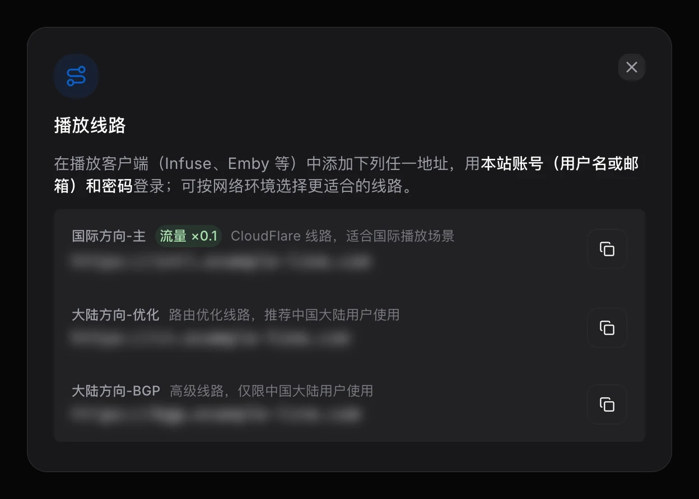

import { Aside } from '@astrojs/starlight/components';

在任意 Emby 客户端中添加服务器时，类型选择 **Emby**，填写以下三项：

| 项目 | 填写 | 获取位置 |
| --- | --- | --- |
| **服务器地址** | 任一线路地址，格式为 `https://域名` | 控制台首页的 **播放线路**（地址默认隐藏，悬停或轻点后显示，可一键复制） |
| **用户名** | Lumen 用户名或注册邮箱 | 与登录控制台相同 |
| **密码** | Lumen 密码 | 与登录控制台相同 |

没有单独的 Emby 密码，客户端登录也不需要两步验证码。

<Aside type="caution">
	订阅生效后才能登录客户端。
</Aside>

## 地址怎么填

- 只有一个地址框：填完整地址，例如 `https://域名`
- 地址与端口分开：地址填域名，协议选 **HTTPS**，端口填 **443**
- 有「路径」：留空

在浏览器中直接打开线路地址会显示 404，这是正常的；要在浏览器里观看，请使用[在线观影](/watch/web/)。

## 多条线路

每条线路都可以单独作为服务器地址。客户端支持备用地址时可以一并填入，不支持时可以把不同线路分别添加为多个服务器。观看进度与收藏保存在服务器上，切换线路不受影响。如何选择线路，请参阅[套餐、线路与流量](/start/plans/#选择线路)。

## 需要重新登录的情况

- 修改或重置了密码，或在[账号设置](/panel/account/)中点击了 **退出所有设备**
- 在[账号设置](/panel/account/#登录设备)的 **播放设备** 中移除了该设备
- 订阅到期后续订，客户端提示登录失效
