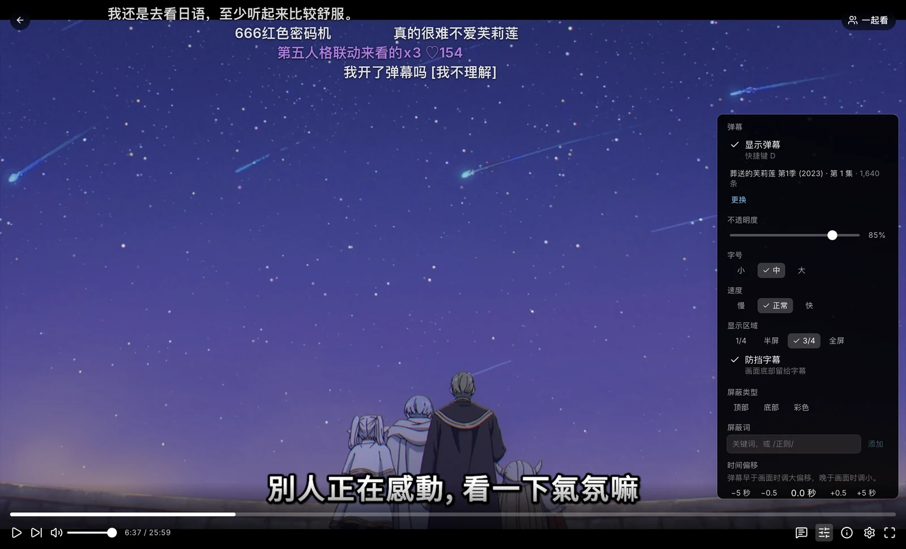

import { Aside, Steps } from '@astrojs/starlight/components';

看剧时可以显示来自国内视频平台的弹幕，并自动匹配到正在播放的剧集和集数。网页播放器直接可用；第三方播放器中，SenPlayer、Rex 会自动加载，其他支持「自定义弹幕 API」的播放器填写一次地址即可。

## 网页播放器

播放时点击控制栏上的 **弹幕设置** 调整样式和屏蔽词。设置只保存在当前浏览器中，换一台设备需要重新设置。

### 匹配有误时

匹配到的作品不对时，在弹幕设置中点击 **更换**，选择正确的作品。这个选择会按剧集的当前季记住，之后各集都按它匹配。弹幕与画面对不上时，可以更换来源，或调整时间偏移。

## 第三方播放器

SenPlayer、Rex 播放时会自动加载弹幕，通常无需设置。Yamby、Hills、ChaiChai、AfuseKt 等支持「自定义弹幕 API」的播放器，按以下步骤设置：

<Steps>

1. 打开控制台的[账号设置](/panel/account/)，在「弹幕」中复制弹幕地址。

2. 在播放器的弹幕设置中选择「自定义弹幕 API」，粘贴该地址。

3. 播放时打开弹幕即可。各播放器的入口名称略有不同，通常在播放界面的弹幕按钮中。

</Steps>

<Aside type="caution">
	弹幕地址只属于您本人，请勿分享给他人。怀疑泄露时，在账号设置中点击 **重置地址**，原地址立即失效，已填写的播放器需要重新填写。
</Aside>

## 没有弹幕的情况

- 国内视频平台没有上线的内容（多数海外剧集、部分动画）没有弹幕来源。
- 刚更新的一集，平台上的弹幕需要一段时间才会出现。
- 某一集没有弹幕而其他集正常时，可能是该集在平台上被拆成了预告或合集，可以手动更换匹配。
