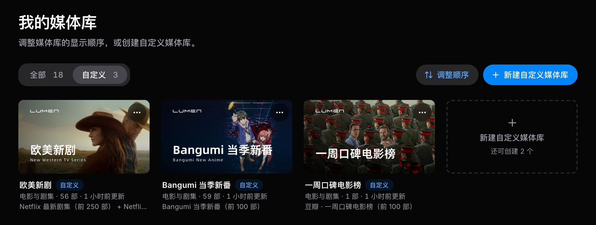

import { Steps } from '@astrojs/starlight/components';

在控制台的 **[我的媒体库](https://www.lumen.ax/dashboard/virtual-libraries)** 中设置，所有客户端和网页同步生效。

## 排序与隐藏

点击 **排序与隐藏**，拖动封面调整顺序，点击眼睛图标隐藏或恢复。隐藏的媒体库里的影片仍可搜索和播放。

## 自定义媒体库

按条件或榜单从片库中自动挑选影片，片库有新内容或榜单更新时自动更新。只收录片库中已有的影片。

<Steps>

1. 点击 **新建自定义媒体库**，填写名称，选择电影、剧集或两者。

2. 点击 **+ 条件** 添加条件：榜单（豆瓣、TMDB、Bangumi、IMDb 等），或影片信息（类型、地区、语言、人物、上映时间、评分等）。

3. 需要时在「手动调整」中指定始终包含或始终排除的影片，确认右侧的预览后点击 **创建**。

</Steps>

多个条件需同时满足；同一个条件里填多项时，满足其中之一即可。需要「满足任一组」时，使用 **+ 条件组**。

| 示例 | 设置 |
| --- | --- |
| 豆瓣 Top250 | 电影；榜单选「豆瓣电影 Top250」 |
| 本季新番 | 榜单选「Bangumi 当季新番」 |
| 高分韩剧 | 剧集；出品地区「韩国」，TMDB 评分不低于 8 |
| 想看清单 | 不加条件，在「始终包含」中逐部加入 |

在[在线观影](/watch/web/)的详情页，也可以把影片直接加入自定义媒体库。
